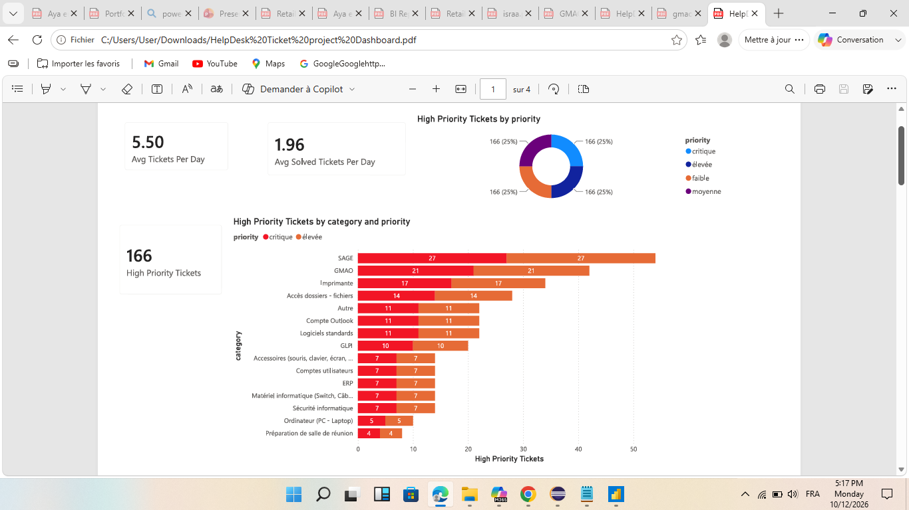
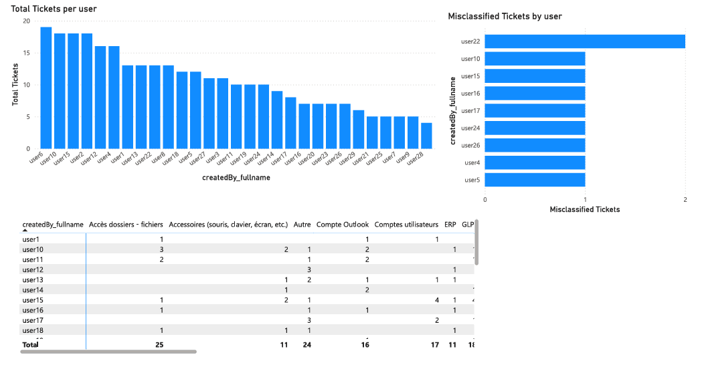
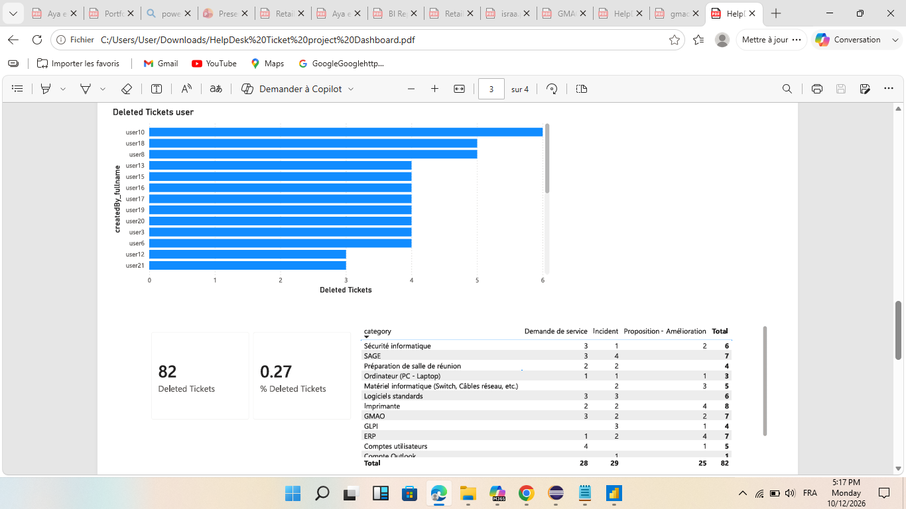
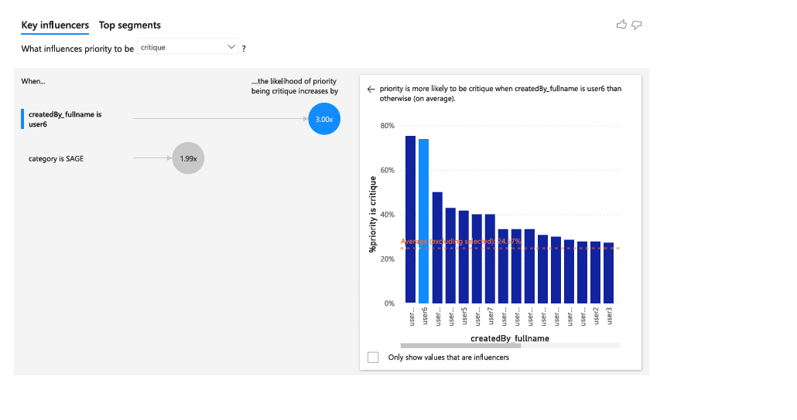

# 🎫 IT Service Desk Performance & Operational Analytics

##  Power BI Executive Dashboard Preview

### 1. High-Priority Ticket Triage & Category Breakdown

---

### 2. User Workload Distribution & Ticket Misclassification

---

### 3. Ticket Deletion Tracking & Intervention Category Matrix

---

### 4. Key Influencers & Root-Cause AI Analytics

---

##  À propos du Projet
Ce projet présente une analyse complète de la performance du support informatique (*IT Service Desk*) au sein de **SOHATRAM GABES** (Juillet 2026). L'objectif principal est d'analyser le volume des tickets, la répartition des priorités, le comportement des utilisateurs, les erreurs de classification et les facteurs clés d'escalade critique à l'aide d'un tableau de bord interactif Power BI.

---

##  Aperçu des Métriques Clés (*Executive Summary*)
* **Volume Quotidien :** Moyenne de **5.50 tickets créés / jour** contre un taux de résolution moyen de **1.96 tickets résolus / jour**.
* **Tickets à Haute Priorité :** **166 tickets au total**, répartis équitablement à 25% entre chaque niveau de priorité (*critique*, *élevée*, *moyenne*, *faible*).
* **Tickets Supprimés & Santé du Système :** **82 tickets supprimés** (soit **0.27%** du volume global).

---

## 🔍 Analyses Détaillées & Résultats

### 1. Répartition des Tickets à Haute Priorité par Catégorie
Les incidents critiques se concentrent principalement sur les logiciels métiers et le matériel de bureau :
* **SAGE :** 1er générateur avec **27 tickets à haute priorité**.
* **GMAO :** 2ème avec **21 tickets à haute priority**.
* **Imprimantes :** **17 tickets**.
* **Accès dossiers - fichiers :** **14 tickets**.
* **Autre, Compte Outlook, Logiciels standards :** **11 tickets chacun**.
* **GLPI :** **10 tickets**.
* **Accessoires, Comptes utilisateurs, ERP, Matériel informatique, Sécurité :** **7 tickets chacun**.
* **Ordinateurs (PC - Laptop) :** **5 tickets**.
* **Préparation de salle de réunion :** **4 tickets**.

### 2. Activité Utilisateurs, Erreurs de Classification et Suppressions
* **Top Générateurs de Tickets :** `user6`, `user10` et `user15` génèrent les volumes les plus élevés (entre 15 et 20 tickets chacun).
* **Erreurs de Classification :** `user22` présente le plus haut taux de tickets mal classés. Les catégories les plus sujettes aux erreurs de saisie sont *Accès dossiers - fichiers* (25 au total) et *Autre* (24 au total).
* **Suppressions de Tickets :** `user10` enregistre le plus grand nombre de suppressions (6 tickets), suivi de `user18` et `user8` (5 tickets chacun).

### 3. Facteurs d'Escalade Critique (*Key Influencers AI Analytics*)
* **Impact Utilisateur (Propension à l'escalade) :** Lorsqu'un ticket est créé par **`user6`**, la probabilité que la priorité soit définie comme **`critique` augmente de 3.00x** (plus de 80% de ses tickets sont classés critiques).
* **Impact Catégorie :** Les tickets appartenant à la catégorie **SAGE** ont **1.99x plus de risques** d'être classés en priorité **`critique`**.

---

##  Recommandations Opérationnelles

1. **Résolution des Bottlenecks Métiers (SAGE & GMAO) :** Mettre en place une maintenance technique ciblée et des formations utilisateurs sur SAGE et GMAO afin de réduire directement l'apparition de tickets critiques.
2. **Standardisation de la Priorisation :** Établir des directives précises et une procédure standardisée (SOP) pour la saisie des priorités afin d'éviter les biais d'escalade observés chez certains utilisateurs (ex. `user6`).
3. **Amélioration de la Classification Initiale :** Redéfinir les formulaires de saisie et les règles de routage automatique sur GLPI/HelpDesk pour limiter les erreurs de catégorie (*Accès dossiers - fichiers*, *Autre*).
4. **Augmentation du Taux de Résolution & Audit :** Accroître la capacité de résolution quotidienne (passer de 1.96 à >5.00 tickets/jour) pour épurer le backlog et auditer périodiquement les suppressions de tickets (`user10`, `user18`).

---

##  Stack Technique
* **Outil Analytics & BI :** Power BI (DAX, Visual Key Influencers, Matrice de classification)
* **Périmètre d'Étude :** SOHATRAM GABES (Juillet 2026)
* **Auteur :** Aya YAHIA
